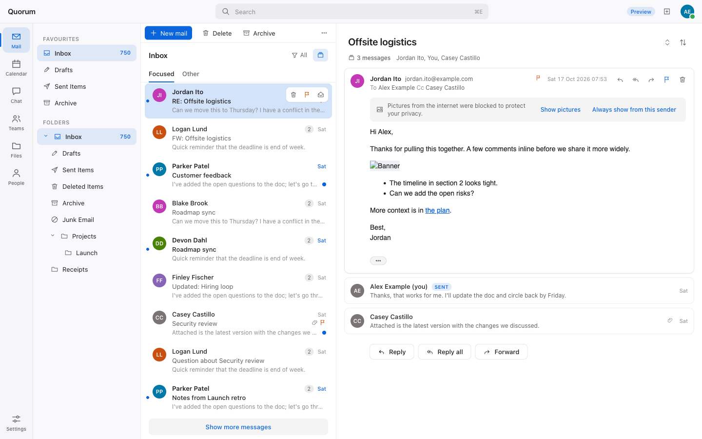
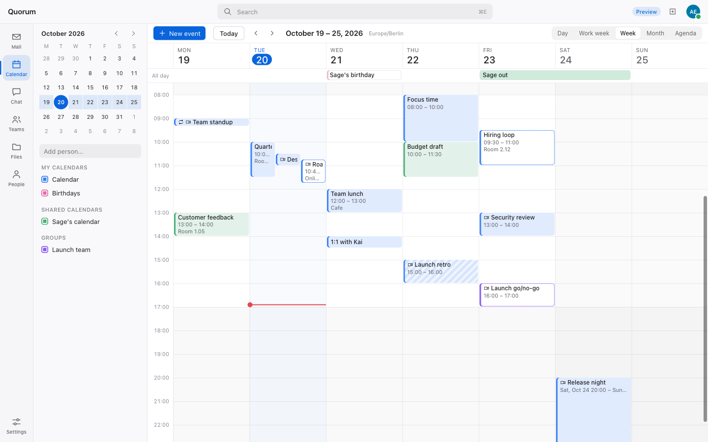
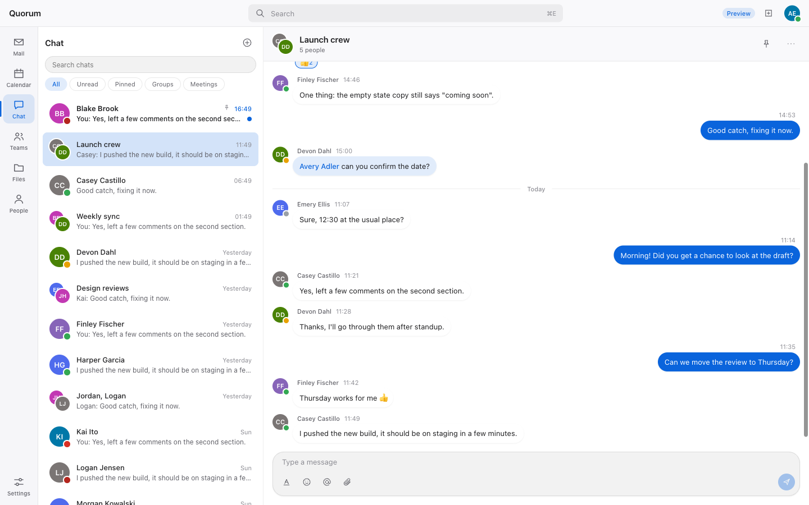
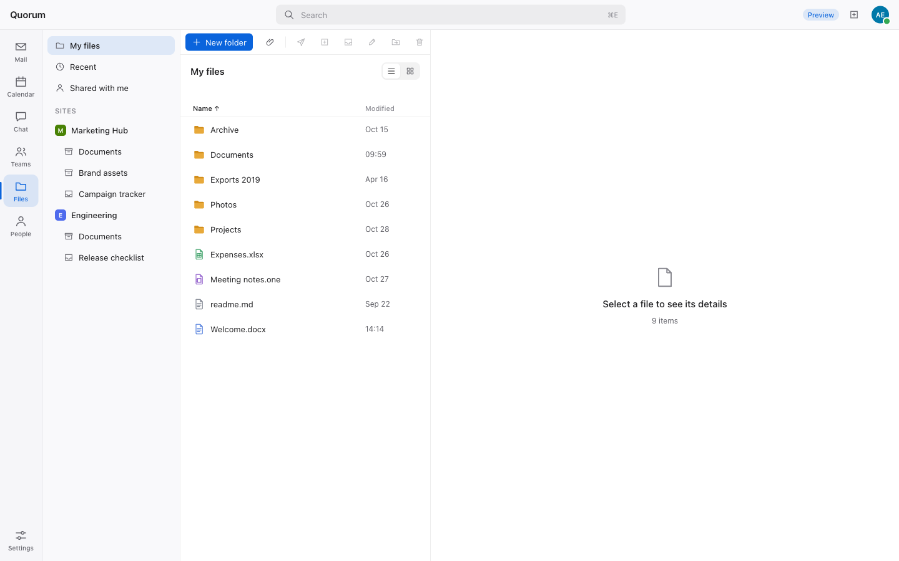

# Quorum

**Your Microsoft 365 work day in one fast, native window.** Mail, one merged calendar, Teams
chats and channels, presence, and OneDrive and SharePoint files, with one sign-in. Written in
Rust, it talks only to Microsoft's documented Graph APIs.

> **Preview.** Quorum is feature-complete against synthetic sample data and has not yet been
> tested on a real tenant at scale. Expect rough edges, and please
> [report what you find](../../issues). macOS first; Windows and Linux use the same stack and
> are next.

Quorum is an independent open-source project. It is not affiliated with or endorsed by
Microsoft.



| Calendar | Chat | Files |
|---|---|---|
|  |  |  |

*Screenshots use made-up sample data (`--mock-graph`).*

## What it does

- **Mail:** focused inbox, conversations across folders with quoted history hidden, quick reply,
  drafts that survive a crash, undo send, flags, categories, automatic replies, and remote images
  blocked by default.
- **Calendar:** your own, shared and other people's calendars merged into one view, free/busy,
  a scheduling assistant, rooms and Teams meetings.
- **Teams:** chats and channels, mentions, reactions, files, and presence. See anyone's
  presence, set your own, and keep it alive while you work.
- **Files:** OneDrive, Shared with me, SharePoint sites, document libraries and lists, sharing,
  versions, and check-in/out.
- **One workspace:** universal search, people cards and org chart, a command palette, and a
  keyboard shortcut for everything ([docs/shortcuts.md](docs/shortcuts.md)).
- **Local-first:** a private copy on your Mac makes it fast and usable offline. Changes sync in
  the background.
- **Automatable:** every action is a command, reachable from the CLI (`quorum-cli`), a local
  control channel and an MCP server, so AI assistants and scripts can work with your mail and
  calendar. Sending, posting and deleting ask you first.

## Get started

### 1. Your IT admin registers Quorum (once per organisation)

Quorum runs on an app registration in **your own** Microsoft Entra tenant. There's no Quorum
server and no third party. An admin opens [Azure Cloud Shell](https://shell.azure.com) and runs:

```bash
curl -fsSLO https://raw.githubusercontent.com/mihirshilpi/quorum/main/scripts/register-quorum.sh
bash register-quorum.sh
```

It creates the registration with delegated permissions only, grants consent, and prints a
**setup link** for colleagues. Portal steps, the permission list and Conditional Access notes are
in **[docs/setup-tenant.md](docs/setup-tenant.md)**.

### 2. Build and run

Prebuilt, signed downloads are coming. Until then, build from source on macOS. You need
[Rust](https://rustup.rs) 1.90 or newer, the wasm target and [Trunk](https://trunkrs.dev):

```bash
rustup target add wasm32-unknown-unknown
cargo install trunk --locked
git clone https://github.com/mihirshilpi/quorum && cd quorum
cargo xtask dev                     # run against your tenant
cargo xtask dev -- --mock-graph     # or try it with sample data, no account needed
```

### 3. Connect your account

Open the setup link from your admin, or paste the tenant and client IDs into the welcome
screen. Then click **Save and sign in** and sign in with your work account in the browser. MFA
and Conditional Access work as usual.

## Security and privacy

- Your data goes only between your computer and Microsoft. There's no telemetry.
- The refresh token is stored in the macOS keychain, and access tokens are kept only in memory.
- Quorum uses delegated permissions only, so it can never do more than you can in Outlook or
  Teams.
- Mail and chat HTML is sanitised in Rust and rendered with scripts disabled.

Details: [SECURITY.md](SECURITY.md) (including how to report a vulnerability) and
[PRIVACY.md](PRIVACY.md).

## How it's built

Quorum is a Tauri 2 desktop shell with a Leptos UI compiled to WebAssembly and pure-Rust crates
for Graph, auth, an encrypted store, sync and a command engine. It follows the
[Microsoft Pragmatic Rust Guidelines](https://microsoft.github.io/rust-guidelines/). Production
code has no `unsafe` and no panics. The design record is in [`plan/`](plan/), starting with
[plan/architecture.md](plan/architecture.md).

```bash
cargo xtask ci       # every gate: fmt, clippy, tests, layering, assets, wasm, licences, fixtures
quorum-cli commands  # everything Quorum can do
```

## Contributing

Issues and pull requests are welcome. Read [CLAUDE.md](CLAUDE.md) for the rules every
contribution follows. Some of them: documented Graph APIs only, no Microsoft brand assets, no
real tenant data in the repo, and `cargo xtask ci` green before a PR. Contributors are credited
in About ▸ Contributors ([docs/contributors.md](docs/contributors.md)).

## Licence

Licensed under either of [Apache License 2.0](LICENSE-APACHE) or [MIT](LICENSE-MIT), at your
option. Unless you say otherwise, any contribution you submit is licensed the same way, with no
additional terms or conditions.

Microsoft, Outlook, Teams, OneDrive and SharePoint are trademarks of the Microsoft group of
companies.
